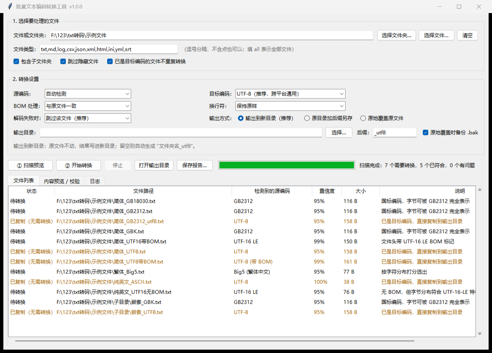

# txt-encoder · 批量文本编码转换工具

[](https://github.com/baijiamingxa/txt-encoder/actions/workflows/ci.yml)

> Batch text-file encoding converter for Windows: GBK / GB2312 / GB18030 / Big5 / UTF-8 / UTF-16 / Shift-JIS / EUC-KR …
> Comes with a GUI (`run_gui.bat`, double-click to run), a CLI, and drag-and-drop conversion.
> Pure Python standard library — zero third-party dependencies. The UI and docs are in Chinese.

一个 Windows 上用起来很顺手的批量转码工具：把一堆 txt / md / csv / log 等文本文件，
从 GBK、GB2312、Big5、UTF-8、UTF-16 等任意一种编码，批量转成你想要的那种编码。

自带图形界面（双击就能用）和命令行（可以写进脚本），**只依赖 Python 标准库，不需要装任何第三方库**。



---

## 一、最快上手

### 方式 1：图形界面（推荐）

双击 **`run_gui.bat`**，窗口打开后：

1. 点“选择文件夹…”挑一个目录（也可以直接把文件夹拖到 `run_gui.bat` 上）；
2. “目标编码”选 UTF-8（默认就是）；
3. 点 **① 扫描预览** —— 工具会先告诉你每个文件现在是什么编码、哪些需要转换；
4. 在列表里点文件，右边“内容预览”能直接看解码结果对不对；
5. 确认没问题，点 **② 开始转换**。

默认是“输出到新目录”，原文件一个都不会动，结果放在源文件夹旁边的 `文件夹名_utf8` 目录里。

### 方式 2：拖一下就转

把文件或文件夹拖到 **`quick_convert_to_utf8.bat`** 上 —— 直接转成 UTF-8（无 BOM），
原文件不动，结果放在旁边的 `_utf8` 目录，并在工具目录生成 `last_report.csv` 报告。

### 方式 3：命令行

```bat
:: 先看看这些文件都是什么编码（不改任何东西）
python txt_encoder_cli.py --detect "D:\稿件"

:: 预演一遍：告诉你会怎么转，但不写盘
python txt_encoder_cli.py "D:\稿件" --target utf-8 --dry-run

:: 真正转换：输出到 D:\稿件_utf8，原文件保留
python txt_encoder_cli.py "D:\稿件" --target utf-8 --report 报告.csv

:: 原地把老 GBK 文件改成 UTF-8（自动生成 .bak 备份）
python txt_encoder_cli.py "D:\稿件" --target utf-8 --mode inplace
```

---

## 二、能做什么

**自动识别源编码**，不用你事先知道文件是 GBK 还是 Big5：

| 识别依据 | 说明 |
| --- | --- |
| BOM 文件头 | UTF-8 / UTF-16 LE / UTF-16 BE / UTF-32 的 BOM，准确率最高 |
| 无 BOM 的 UTF-16 | 按 NUL 字节的分布判断字节序（LE / BE） |
| 严格 UTF-8 校验 | 能严格解通 UTF-8 的，基本就是 UTF-8 |
| 双字节结构分析 | GB 系（GB2312/GBK/GB18030）的尾字节几乎都在 0xA1-0xFE；Big5 约一半落在 0x40-0x7E，用这个区分简繁中文 |
| 字符分布打分 | 逐个候选编码试解，按“解出来像不像正常文本”打分，最高分当选 |

支持的编码：UTF-8 / UTF-8 BOM / UTF-16(LE/BE) / UTF-32 / GB2312 / GBK / GB18030 /
Big5 / Big5-HKSCS / Shift-JIS / EUC-KR / Windows-1252(ANSI) / Latin-1 / ASCII，
以及任何 Python 认识的编码名（比如 `cp936`、`utf-16-le`）。

**批量转换**的三件事：

| 项目 | 可选做法 |
| --- | --- |
| 换行符 | 保持原样 / 统一 CRLF（Windows）/ 统一 LF（Unix）/ 统一 CR |
| BOM | 与原文件一致 / 不添加 / 添加 / 按编码惯例 |
| 输出方式 | 输出到新目录（默认，最安全）/ 原目录加后缀另存 / 原地覆盖（自动备份 .bak） |

---

## 三、为什么可以放心用

* **默认不改原文件**：输出到新目录，并保留原有的子目录结构。
* **先预演再执行**：`--dry-run` 或界面上的“① 扫描预览”，会算出每个文件会变成什么样，但不写盘。
* **原子写入**：先写临时文件再替换，断电或中断也不会留下半个文件。
* **能转就转，不能转就报错**：比如想把中文转成 ASCII，工具会明确告诉你“目标编码无法表示某个字符”，而不是塞一堆 `?` 进去；解码失败的文件原样保留。
* **自动跳过**：已经是目标编码的文件不会重复转换；二进制文件（图片、压缩包）会被识别出来跳过。
* **可核对**：转换结果可以导出 CSV 报告（界面上的“保存报告”），里面有每个文件的源编码、置信度、字节数变化。

> 唯一需要小心的是“原地覆盖”。界面选到这一项会有确认提示；命令行请保留默认的 `--no-backup` 不要加，也就是让 `.bak` 备份生效。

---

## 四、命令行参数速查

```
python txt_encoder_cli.py <路径...> [选项]

  -s, --source       源编码，默认 auto 自动检测
  -t, --target       目标编码，默认 utf-8
  -b, --bom          keep(默认) / none / add / default
  -n, --newline      keep(默认) / crlf / lf / cr
  -m, --mode         newdir(默认) / suffix / inplace
  -o, --out          输出目录（mode=newdir 时用）
  -e, --ext          处理的扩展名，如 txt,md,log；all 表示全部文件
  -r, --recursive    递归子目录（默认开）；--no-recursive 关闭
      --no-skip-same 已是目标编码也重新写一遍
      --no-backup    原地覆盖时不备份（危险，不推荐）
      --on-error     skip(默认) / replace：解码失败时跳过或用替代字符继续
      --dry-run      只预演不写盘
      --detect       只检测编码，不转换
      --jobs N       并发线程数（文件很多时可设 4~8 提速）
      --report 文件  把结果写成 CSV 报告
      --list-encodings  列出所有支持的编码名
```

---

## 五、目录里都是什么

| 文件 | 作用 |
| --- | --- |
| `run_gui.bat` | **双击启动图形界面** |
| `quick_convert_to_utf8.bat` | 把文件/文件夹拖上去，一键转 UTF-8 |
| `txt_encoder_gui.py` | 图形界面源码 |
| `txt_encoder_cli.py` | 命令行源码 |
| `txt_encoder_core.py` | 核心引擎（编码检测 + 转码），可被其它脚本 import |
| `make_sample_files.py` | 生成一批各种编码的示例文件，方便试手 |
| `selftest.py` | 功能自检（40+ 项断言） |
| `gui_smoketest.py` | 图形界面自动冒烟测试（自动创建窗口、跑完扫描+转换） |
| `.github/workflows/ci.yml` | 持续集成：Ubuntu / Windows × Python 3.9 / 3.12 / 3.13 上跑自检和命令行全流程 |
| `.gitignore` / `.gitattributes` | 忽略临时产物、统一换行符 |
| `LICENSE` | MIT 许可证 |

想试手的话，先让工具自己造一批样例：

```bat
python make_sample_files.py
```

它会在 `示例文件\` 目录里生成 12 个样例（GBK / GB2312 / GB18030 / Big5 / UTF-8 / UTF-8 BOM /
UTF-16 / 无 BOM 的 UTF-16 / 纯英文 / 子目录嵌套 / 一个二进制文件），
正好可以把本工具的各种识别分支都走一遍。这些演示文件不会提交到仓库里。

想把核心引擎用在别的脚本里：

```python
from txt_encoder_core import ConvertOptions, convert_file, detect_file

print(detect_file("老文件.txt").describe())      # 看看是什么编码

opts = ConvertOptions(target_encoding="utf-8", output_mode="newdir")
result = convert_file("老文件.txt", opts, root=".")   # 转成 UTF-8
print(result.summary())
```

---

## 六、环境要求与自检

* Python 3.9 以上（开发环境是 3.14），**无需 pip 安装任何东西**。
* 每次推送都会在 GitHub Actions 上自动跑一遍：Ubuntu + Windows 两个平台，Python 3.9 / 3.12 / 3.13
  三个版本，内容是语法检查、`selftest.py` 全部断言、生成示例文件、命令行真实批量转换并上传报告。
* 想确认环境没问题，双击运行：

```bat
python selftest.py        :: 全部通过 ✔ 说明检测和转码逻辑正常
python gui_smoketest.py   :: 全部通过 ✔ 说明图形界面正常
```

---

## 七、常见问题

**Q：转完之后 Excel / 记事本还是乱码？**
Excel 打开 CSV 默认按系统 ANSI 编码读。要么目标编码选 `GBK（Windows 记事本“ANSI”）`，
要么选 `UTF-8（带 BOM，Excel/旧版记事本友好）`，让 Excel 知道这是 UTF-8。

**Q：GBK、GB2312、GB18030 该选哪个？**
GB2312 是最老、字最少的国标；GBK 是它的超集（Windows 上的“ANSI”就是 GBK）；
GB18030 又是 GBK 的超集，能表示全部汉字。**不确定就选 GB18030**，
它能完整读回 GBK / GB2312 的内容。

**Q：识别出来的是 GB2312，但我记得文件是 GBK 存的？**
如果文件里的字全都能用 GB2312 表示，两者字节完全相同，工具会报最精确的那个名字，
对转换结果没有任何影响。

**Q：BOM 是什么，要不要加？**
BOM 是文件开头三个字节（EF BB BF），用来告诉程序“这是 UTF-8”。
中文环境下如果文件主要给程序、网站、Git 用，**不要加**；如果主要给 Excel 打开，建议加。
默认“与原文件一致”可以保持原有风格不变。

**Q：会不会把我的文件改坏？**
默认不会动原文件；转换失败的文件一律保持原样；原地覆盖会先备份 `.bak`。
另外强烈建议先用“扫描预览 / --dry-run”看一眼再执行。

---

## 八、许可证

本项目采用 MIT 许可证，见 [LICENSE]。
欢迎提 Issue、PR，或者把它改成你自己需要的样子。
