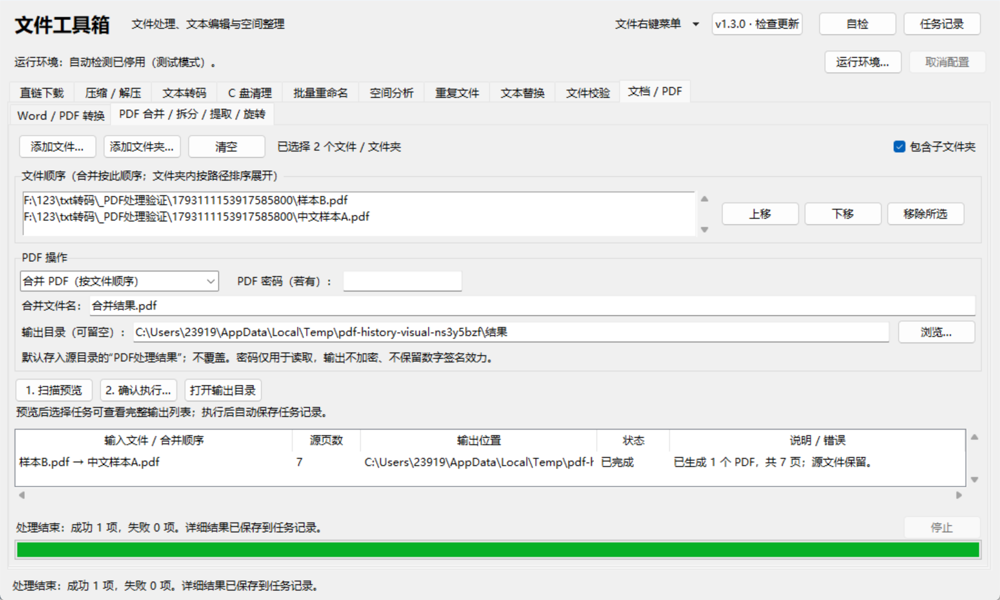
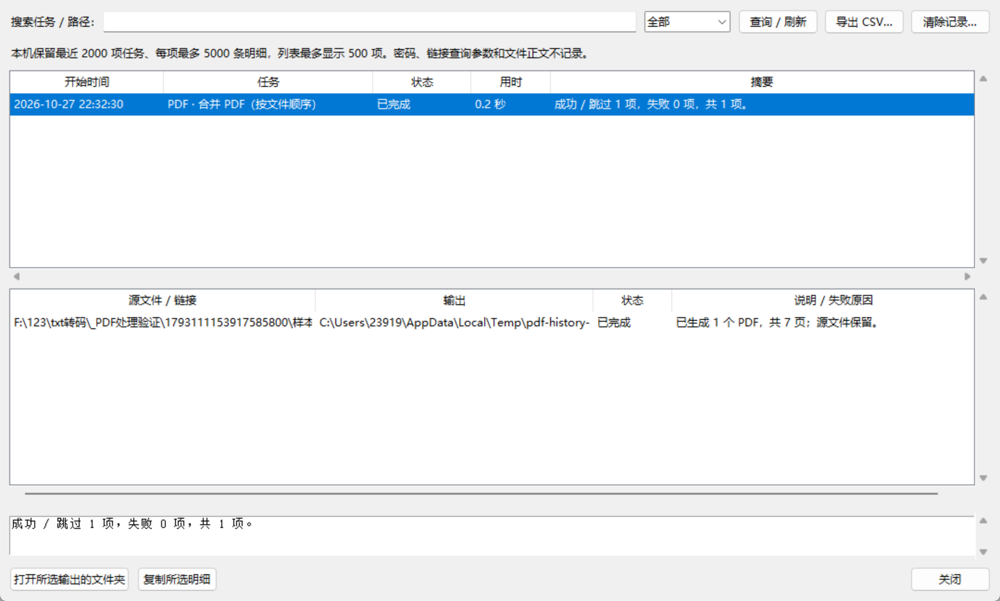

# PDF 常用操作与任务记录（1.3.0）

本版继续使用现有 PDF 运行组件，没有新增第三方依赖。安装包的构建和安装方式与 1.2.0 相同。

## PDF 操作

在“文档 / PDF”页签内切换到“PDF 合并 / 拆分 / 提取 / 旋转”。

1. 添加 PDF 文件或文件夹。文件夹按路径排序展开；合并时按文件列表顺序处理，可用上移 / 下移调整输入顺序。
2. 选择操作。合并可自定义结果文件名；拆分设置每份页数，最后一份允许不足；提取和旋转设置页码范围。
3. 页码从 1 开始，例如 `1-3,5,8-10`；留空表示全部。提取支持 `3,1` 这样的页序，重复页码、倒置区间和越界页码会阻止任务。
4. 旋转为在原方向上顺时针增加 90 / 180 / 270 度，仅影响选定页面。其它页面保持原有方向。
5. 设置输出目录；留空时生成源目录中的“PDF处理结果”。先扫描预览，再确认执行。

源文件始终保留，已有同名结果不会覆盖。同名输入造成输出冲突时需分批处理或分别选择输出目录。
合并遇到无法读取、密码不正确或损坏的输入时，会阻止整个合并任务，不会悄悄漏掉文件。
扫描后源内容发生变化必须重新预览，包括只修改内容又恢复修改时间的情况。

扫描和执行均使用独立受保护的工作进程，单项默认超时 20 分钟。可停止或关闭窗口终止本次工作进程。
拆分结果逐个发布；取消、磁盘写入失败或其它程序抢先创建同名输出时，已经成功发布的部分保留，未完成部分不发布。
任务记录会分别标注成功输出和未完成原因。

同一批次使用页面填写的同一个 PDF 密码；不同密码的文档可先分别提取为未加密副本，再合并副本。
密码只用于读取源文件，不保存到任务记录。输出 PDF 不加密，不保留原数字签名的有效性。
合并 / 拆分不承诺保留原文档级书签、附件和跨文件链接；需要保留这些结构时请先核对结果。
页面操作不做 OCR，也不重排页面文字，不对图像做有损压缩。

底层页面 API 参见 [PyMuPDF Document](https://pymupdf.readthedocs.io/en/latest/document.html) 与
[Page rotation](https://pymupdf.readthedocs.io/en/latest/page.html#Page.set_rotation)。

## 统一任务记录

主页右上角点击“任务记录”。涵盖下载、压缩 / 解压、TXT 检测 / 转码、清理扫描 / 执行、重命名 / 撤销、空间扫描 / 查重 / 回收、文本替换、文件校验 / 清单比对、Word/PDF 转换及 PDF 操作。
只扫描预览而未执行的文档、PDF、文本替换和重命名操作不产生执行记录。

每项包含开始与结束时间、用时、结果摘要及逐项输入、输出、状态和失败原因。
可按任务名 / 路径搜索、按状态筛选，选择明细后复制或打开输出所在文件夹；已移动或删除的输出会提示不存在，不会自动重建或重新执行。
CSV 导出当前筛选范围的全部保留记录，而非仅导出可见的 500 项；文件为 UTF-8 BOM，并防止文件名被表格软件当作公式执行。

状态包括进行中、已完成、部分完成、失败、已取消、意外中断。
异常退出后，下次启动将上次遗留的进行中记录标为“意外中断”，不会自动重试或回滚文件。
重命名日志和文本替换备份路径会出现在明细中；撤销重命名仍在原工具页操作，记录窗口不直接修改业务文件。

记录保存在 `%LOCALAPPDATA%\文件工具箱\任务记录.sqlite3`，仅本机保存，不上传。
只保存路径、必要的摘要和校验值，不保存文件正文、完整选项对象或密码。
下载 URL 会去掉用户凭据、查询参数与 fragment，避免带签名的临时链接写入记录。
保留最近 2000 项已结束任务，每项最多 5000 条明细；统计使用完整结果，截断时摘要会提示。
列表最多显示 500 项，可用筛选定位历史任务。进行中的记录不会被清除或自动淘汰。

“清除记录”在选中任务时清除所选项，未选中时清除全部已结束任务，执行前会确认；只处理记录，不删除源文件、结果、备份或重命名日志。
记录库不可用时文件任务仍可执行，记录窗口会展示错误提示。

## 验证

`python pdf_history_selftest.py` 运行离线页码、冲突、并发写入、持久化、隐私、CSV、取消与失败保护检查，不需要文档第三方库。
安装文档依赖后，`python pdf_history_selftest.py --real` 验证真实合并顺序、拆分页数、提取顺序、相对旋转、中文和加密输入。
测试样本和渲染图保存在忽略提交的 `_PDF处理验证`。
`python toolbox_gui_smoketest.py` 额外检查 PDF 界面、最小窗口布局、全工具记录、筛选、导出和清除记录后的结果保护。
