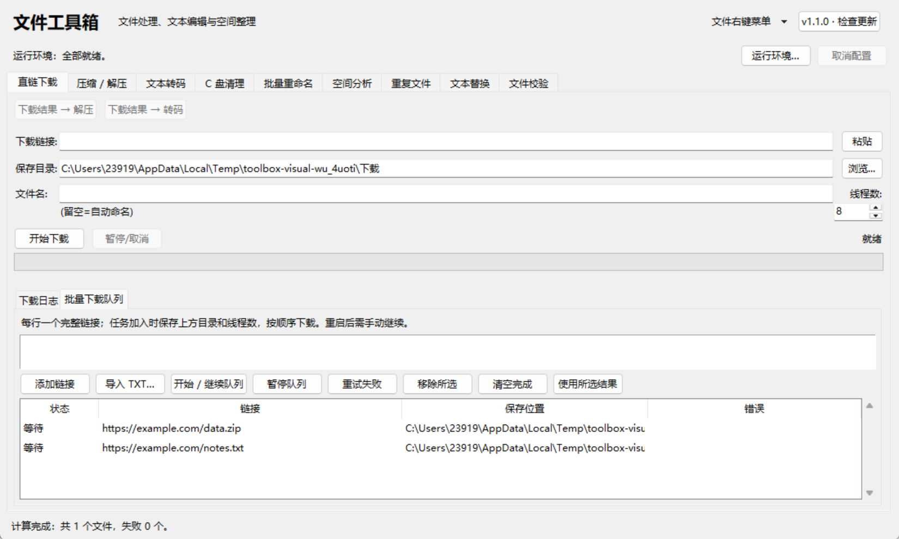
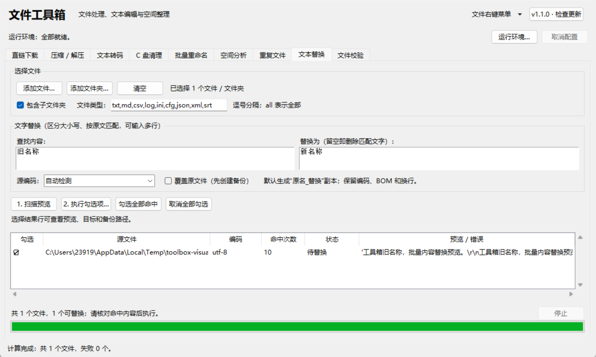
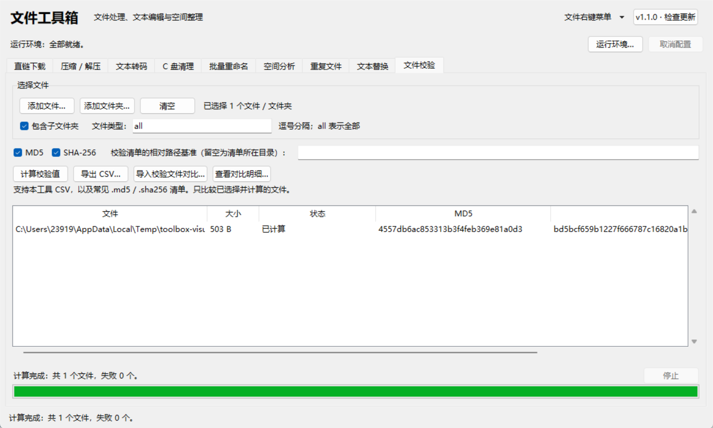
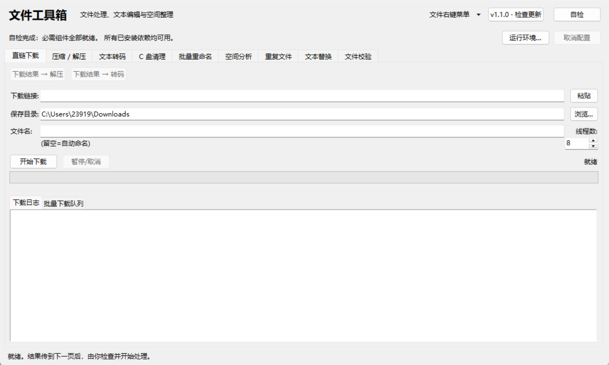
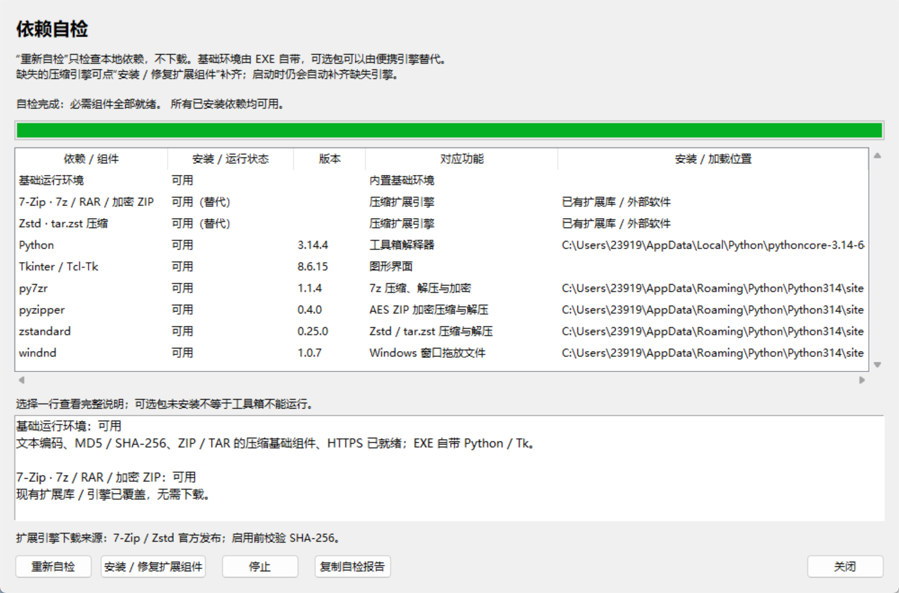
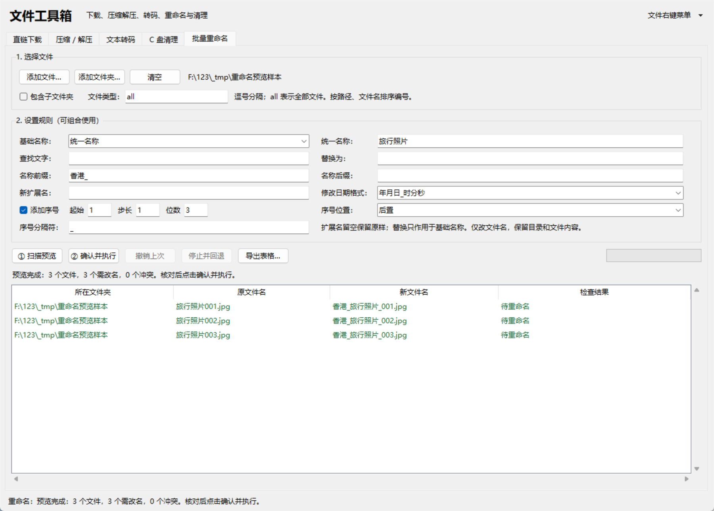
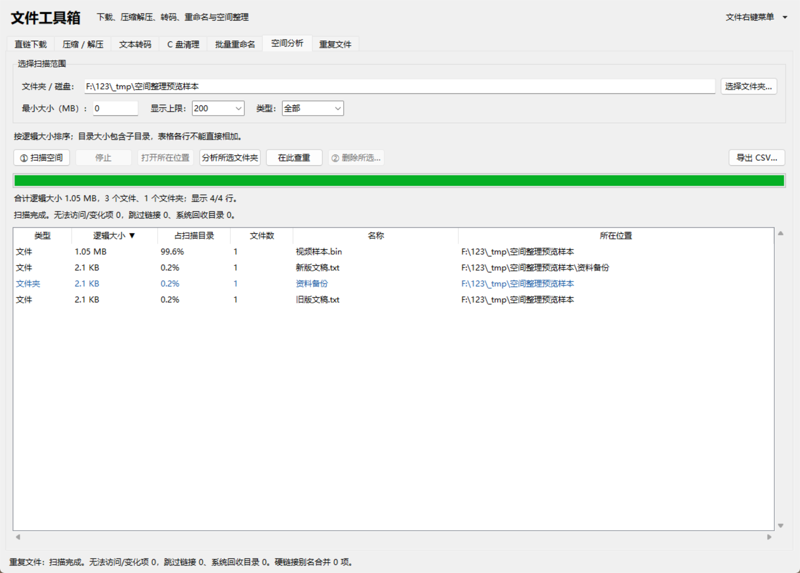
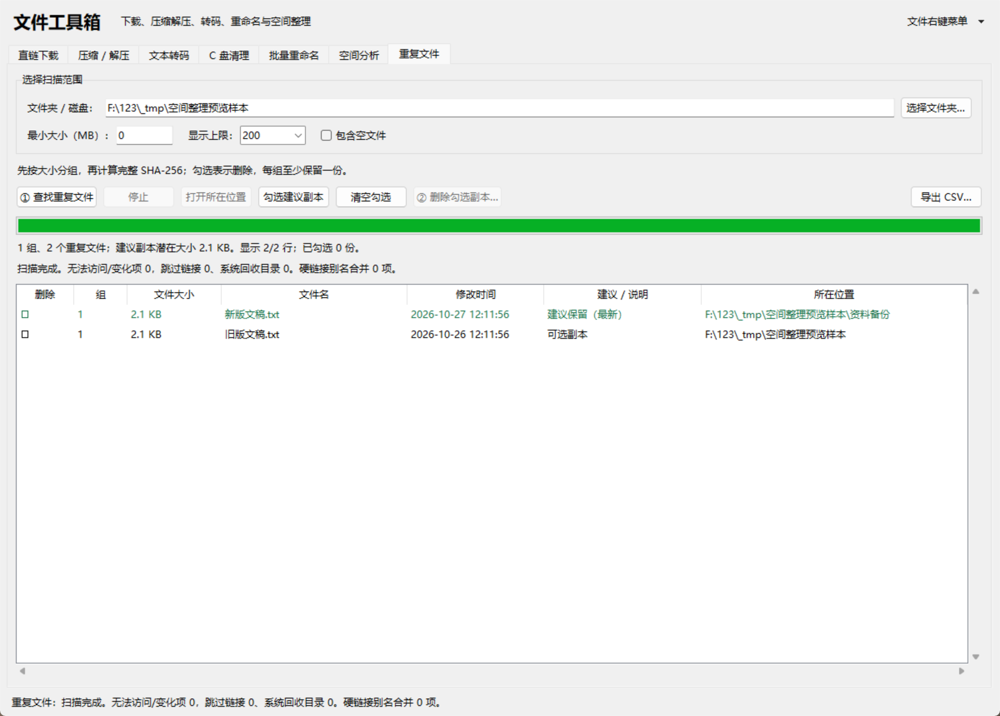

# 文件工具箱使用与合并说明

## 启动

Windows 双击项目目录里的 `启动文件工具箱.bat` 或 `run_gui.bat`。
启动器使用本机 Python，优先无控制台窗口的 `pyw` / `pythonw`。
源码运行需要 Python 3.9 或以上版本及 tkinter；无需新增第三方包。

也可以打包成单文件 exe，双击运行、无需安装 Python：

```bat
py -m pip install pyinstaller    :: 只需装一次
py build_exe.py
```

产物是 `dist\文件工具箱.exe`，可单独拷贝使用。设置文件跟随 exe 存放
（所在目录不可写时改存到 `%APPDATA%\文件工具箱`）；在窗口里安装的右键菜单指向这个 exe。
首次运行如遇 SmartScreen 提示，点“更多信息 → 仍要运行”。

EXE 内嵌蓝色工具箱图标，包含 16～256 像素的九个尺寸。窗口标题栏、任务栏和右键入口使用同一设计。
源码图标和生成提示词保存在 `assets/`；可运行 `build_icon.ps1` 重新转换 ICO，再运行 `py build_exe.py` 打包。

当前工具箱版本为 **1.1.0**，含九个页签。原转码命令行的版本号和接口保持兼容。

## 重复启动与版本提醒

同一用户重复双击 EXE 或启动器时，唤回已有窗口，不再新开主窗口；最小化的窗口会恢复。
从右键菜单传来的 TXT、压缩包和链接也会转交给该窗口，中文、空格及 `& ! %` 字符原样保留。
转码任务进行时先暂存传入的文件，任务结束后再加入输入，不中断当前工作。
Windows 对前台焦点有限制，系统不允许立即激活时会闪烁任务栏提示。
本地通信只监听 `127.0.0.1` 的随机端口，以用户目录文件锁和随机令牌区分实例，
退出或进程崩溃后文件锁自动释放；不会因为遗留锁文件而永久阻止下次启动。

右上角 **“v1.1.0 · 检查更新”** 可查看当前版本、版本说明和手动检查结果。
默认启动后后台查询 `api.github.com` 的当前仓库最新正式 Release，每天成功查询最多一次；
不查询预发布版，也不把普通 Git 提交或标签当作已发布更新。
发现更高版本时按钮显示“新版本 … 可用”，由你主动打开 GitHub 发布页。
不会自动下载或替换正在运行的 EXE；断网不会弹出启动阻断对话框，可在更新窗口重试。
更新窗口可关闭自动检查。更新设置保存在 `%LOCALAPPDATA%\文件工具箱\更新设置.json`，
查询使用直连 HTTPS，不包含访问令牌或写死的代理端口。
接口规则参见 [GitHub Release API](https://docs.github.com/en/rest/releases/releases#get-the-latest-release)。

## Windows 文件右键菜单与打开方式

双击 `安装右键菜单.bat`，或在工具箱右上角“文件右键菜单”中选择“安装 / 更新右键菜单”。
随后右键 TXT 或压缩包，点击“通过文件工具箱打开”。TXT 自动进入转码页；压缩包自动进入解压页。
文件会先加入输入或任务列表，等你核对参数并开始处理。

注册范围是当前用户，共 25 种扩展名：
`.txt`、`.zip`、`.7z`、`.rar`、`.tar`、`.gz`、`.bz2`、`.xz`、`.zst`、`.tgz`、`.tbz`、
`.tbz2`、`.txz`、`.tzst`、`.cab`、`.iso`、`.arj`、`.lzh`、`.lha`、`.jar`、`.whl`、`.apk`、
`.001`、`.r00`、`.z01`。tar.gz 等复合后缀通过最后的 `.gz` 等扩展名获得菜单。
额外压缩格式可使用启动时自动配置的便携引擎。分卷 ZIP 的 `.z01` 会归到同名 `.zip` 的解压任务中。

同时将“文件工具箱”加入“打开方式”候选列表，原默认打开程序保持不变。
Windows 11 的传统菜单入口在“显示更多选项”中，参见 [Microsoft 的说明](https://blogs.windows.com/blog/2021/07/19/extending-the-context-menu-and-share-dialog-in-windows-11/)。
右键菜单针对单个文件；批量处理时，在工具箱内选择多个文件或整个目录。

需要移除时双击 `移除右键菜单.bat`，或使用窗口内的“移除右键菜单”。
移动或重命名工具箱目录后，重新安装一次菜单，更新指向程序的绝对路径。

命令行操作：

```bat
py windows_integration.py --install
py windows_integration.py --status
py windows_integration.py --uninstall
```

实现只写入 `HKCU\Software\Classes` 下本工具专用的 ProgID、各扩展名的
`OpenWithProgids` 候选项，以及 `SystemFileAssociations` 下的专用菜单命令。
移除时只删除这些专用项。命令优先直接调用 Python 无控制台解释器并将文件路径作为一个参数传递，
不经过 cmd，保留中文、空格、`&`、`!`、`%` 等文件名字符。

也可以在终端执行 `py file_toolbox.py`。将文件或文件夹拖到启动器上，会按内容识别：
TXT 和目录加入转码页；压缩包按扩展名或内容识别后加入解压页。
单个 HTTP/HTTPS 链接参数只填入下载框；多个链接加入批量队列，等待手动开始。

## 三个工具怎么衔接

1. 在“直链下载”页输入 URL、保存目录、可选文件名及线程数，点击“开始下载”。
2. 下载完成后，点击“下载结果 → 解压”，压缩包加入任务列表。核对目录后点击“开始解压”。
3. 解压成功后，点击“解压结果 → 转码”。选中任务时只取所选成功结果，不选择时取全部成功结果。
4. 在“文本转码”页设置目标编码和输出目录，点击“扫描预览”，核对内容后再点击“开始转换”。

普通文本下载完可直接点击“下载结果 → 转码”。切换页签不会停止后台任务。
转码已有任务进行时，会提示等待当前任务结束后再传入下一批文件。
结果加入转码页后，之前的扫描缓存会失效，下一次按新输入重新扫描。

默认转码输出到新目录。解压仍采用原工具的行为：写入所选目录，默认按压缩包名称建立子目录；
解压到已有同名文件时会覆盖它。建议为不同批次选择不同的空输出目录。
下载自动命名会避开已有文件；手填文件名已存在时会提示改名，原文件保留。
暂停或关闭时保留下载断点，重新下载同一链接、同一保存路径可继续。
关闭窗口会先发送停止请求，再等当前后台工作收尾后退出；网络请求可能要等超时才结束。

## 批量链接下载队列

在“直链下载”页下半部分切换 **“批量下载队列”**：每行粘贴一个完整 HTTP / HTTPS 链接，
点击“添加链接”，或选择“导入 TXT”。支持 UTF-8、带 BOM 文本和可识别的旧编码 TXT；
空行、以 `#` 开头的注释忽略，相同链接与相同保存目录的任务去重。TXT 最大 4 MB，队列最多 5000 条。

加入时记录当前保存目录和线程数，单任务的手填文件名不用于队列；每条链接单独按服务器 / URL 自动命名。
点击“开始 / 继续队列”后顺序执行，每个任务内部仍使用原分段、失败重试和续传逻辑。
重名自动加序号，恢复任务保留原来的完整保存路径，不覆盖已有的完整文件。
单项失败会继续下一项；“重试失败”把失败任务放回等待状态，再点击继续即可重试。
“暂停队列”保留当前断点并停止取下一项，随后可续传。

队列保存在 `%LOCALAPPDATA%\文件工具箱\下载队列.json`，包括链接、目录、路径、线程数和状态；
因此带查询参数的链接也会随队列保存。重启后原下载中任务标为暂停，需你手动继续，不自动联网下载。
“移除所选”和“清空完成”只删除队列记录，不删除下载文件或断点；当前正在下载的一项不能移除。
选择已完成任务，点击“使用所选结果”，即可使用上方“下载结果 → 解压 / 转码”按钮。



## 批量文本内容替换

在“文本替换”页添加文件或文件夹，设置扩展名和是否包含子目录；支持多行查找与替换，
采用区分大小写的原文匹配，不解释正则表达式或 `\\n` 这样的转义写法（换行请直接输入）。
空替换内容表示删除匹配文字，查找内容不能为空。每项规则最多 65536 个字符。

先“扫描预览”：每行显示源编码、命中次数、状态及第一处命中的前后内容；可勾选或取消文件。
选择行可查看副本目标及备份位置。“执行勾选项”再次列出文件与替换次数，确认后才写盘。
默认生成同目录的 `原名_替换.扩展名` 副本；已有目标不覆盖。
勾选“覆盖原文件”时，每个文件先生成 `原名.replace-backup-时间-随机号` 完整备份，再原子替换。
本次已完成项目会保留，失败或取消的当前文件不会被半成品覆盖；原地备份可手动恢复。

按原编码严格读写，保留 BOM 和 CR / LF 换行；跨读取块的文字和多字节字符也能匹配。
自动检测置信度低于 80% 时跳过并要求指定编码；指定编码与 BOM 冲突、内容含 NUL 或替换文字不能
用原编码表示时会提前报错，不用问号或丢弃字符代替。自动检测仍属于启发式识别，执行前应核对预览。
执行前重新检查文件身份、修改时间及完整 SHA-256，源文件变化后必须重新预览；改变规则会清空旧预览。



## 文件校验

“文件校验”支持添加多个文件或整个目录，一次读取同时计算 **MD5 / SHA-256**，可只选择其中一个。
计算过程中遇到文件修改，结果标为失败。CSV 使用 UTF-8 BOM，列为 `path,size,md5,sha256,error`，
记录完整路径和文件大小，可供其它工具使用或重新导入。

导入校验文件前先选择文件并计算校验值，支持本工具 CSV，以及常见的
`哈希值  文件名` / `哈希值 *文件名` 格式的 `.md5`、`.sha256` 和 TXT 清单。
相对文件名默认以清单所在目录为基准，也可在上方指定基准目录。校验清单最大 32 MB。
导入时重新计算已选择文件，避免把旧计算值当作当前结果；不会根据外部清单去读取未选择的任意文件。
结果区分“一致”“不一致”“未选择此文件”“未计算此算法”“计算失败”，完整结果可点“查看对比明细”。
校验记录互相矛盾或格式有误时明确报错。只有清单比对过的算法会给出一致结论。



## 压缩格式和可选引擎

| 格式 / 功能 | 标准库能否直接使用 | 扩展支持 |
| --- | --- | --- |
| 普通 ZIP（含 ZipCrypto 解密）、tar、tar.gz、tar.xz | 可以 | ZIP 并行压缩/解压，中文名修复 |
| gz、bz2、xz 单文件解压，tar.bz2 解压 | 可以 | 自动识别内容 |
| 7z | 不可以 | 自动配置的 7-Zip 支持压缩、解压与加密；也兼容已有 py7zr / WinRAR |
| AES ZIP | 不可以 | 自动配置的 7-Zip；也兼容已有 pyzipper / WinRAR |
| zst / tar.zst | 不可以 | 7-Zip 解压，Zstd 压缩 tar.zst；也兼容已有 zstandard |
| RAR / CAB / ISO 等 | 不可以 | 自动配置的 7-Zip 或已有 WinRAR / UnRAR；RAR 仅解压 |
| 窗口内拖拽文件 | 不可以 | 已安装的 windnd；不具备时仍可使用“添加压缩包”按钮 |

原工具的可选接口保留；便携引擎通过子进程调用，不向冻结的 EXE 里安装 Python 扩展包。
ZIP、tar 等格式的分卷归组也保留，实际能否解开由对应引擎决定。
使用 7-Zip 后端创建 AES ZIP 时密码限 ASCII 字符；中文密码请选 7z。已有 pyzipper 的行为保持兼容。

## 首次启动运行环境自检

主页右上角提供独立的 **“自检”** 按钮：点击即打开依赖检查窗口并执行一次本地检查。
启动检查尚未结束时，点击会显示正在进行的检查，不会重复创建检测线程。
表格逐项列出对应功能、安装 / 运行状态、版本和加载位置：

- Python 和 Tkinter / Tcl-Tk：显示当前解释器、版本和界面可调用状态。
- 基础环境：实际验证文本编码、MD5 / SHA-256、ZIP / TAR、gzip / bz2 / xz、HTTPS。
- py7zr：创建 7z 小样本并读取、解压校验。
- pyzipper：创建 AES ZIP 小样本，再用密码解密核对内容。
- zstandard：压缩 / 解压小样本并核对内容。
- windnd：检查 Windows 拖放接口是否可调用，不额外注册窗口钩子。
- 便携 / 系统 7-Zip 和 Zstd：检查文件校验及控制台引擎可运行性，或明确标注功能由现有库替代。

状态区分“可用”“未安装（可选）”“加载失败”“自检失败”和非 Windows 的“不适用”。
缺少 Python 传递依赖或 DLL 无法加载会展示具体错误；包能导入但样本操作失败不会显示为可用。
EXE 自带的包会标注为随 EXE 提供，无需在系统 Python 中重复安装；没有独立便携引擎时不会冒报它的版本号。
选择结果行查看完整说明，点击“复制自检报告”可复制全体结果、版本、路径和错误。

**“重新自检”仅做本地检查，不联网下载。** “安装 / 修复扩展组件”沿用自动配置流程，
为缺失或损坏的压缩引擎补齐经过校验的便携组件；不会向 EXE 中运行 pip 或重装可选 Python 库。
可选库缺失时可使用便携替代引擎；windnd 缺失时仍可用文件选择按钮。
出现“加载失败 / 自检失败”时请查看具体错误，修复便携组件不等于重新安装损坏的 Python 包。





工具箱主窗口出现后自动后台检测，不会阻塞其它工具。基础检测实际往返验证文本编码、
ZIP / TAR、gzip / bz2 / xz、SHA-256 及 HTTPS 上下文。EXE 自带 Python 和 Tk，使用者不需要另装 Python。

扩展功能不足时自动补齐以下组件，安装后当次即可使用：

- **7-Zip 26.05**：7z 压缩解压、AES ZIP、RAR 等扩展格式解压。
- **Zstd 1.5.7**：tar.zst 压缩（解压由 7-Zip 或现有 zstandard 处理）。

优先检查工具箱专用组件、满足指定版本的系统引擎，以及已能覆盖对应功能的原有库。
缺失或文件损坏才下载，后续启动只做本地校验。运行组件在
`%LOCALAPPDATA%\文件工具箱\运行组件\`，按版本和架构分目录；不修改系统 PATH、文件关联或系统软件目录。
64 位、32 位和 ARM64 Windows 分别选择对应 7-Zip；ARM64 的 Zstd 使用 x86 兼容程序。
自动配置仅支持 Windows；其它系统仍可使用原标准库功能和已有可选库。

下载使用系统 / 环境代理，来源固定为
[7-Zip 官方发布](https://github.com/ip7z/7zip/releases/tag/26.05)及
[Zstandard 官方发布](https://github.com/facebook/zstd/releases/tag/v1.5.7)。
每个发布包都有固定 SHA-256，下载完成必须比对通过；7-Zip 的哈希与官方 GitHub 发布资产 digest 一致，
Zstd 的固定哈希由维护者下载官方版本后记录。7-Zip 包只是经校验的 7zr 解包，不执行安装程序，
只取控制台引擎及许可文件。Zstd ZIP 只取 `zstd.exe`，并附上官方 BSD 许可。
7-Zip 引擎使用 GNU LGPL / unRAR 限制等许可，详见组件目录的 `License.txt`；
[7-Zip 官网提供源代码及完整许可](https://www.7-zip.org/)，
[Zstd 源码和许可](https://github.com/facebook/zstd/tree/v1.5.7)也可直接查阅。

右上角 **“自检”** 和 **“运行环境…”** 可以查看状态和错误详情、停止正在进行的检查或配置，
并分别选择“重新自检”或“安装 / 修复扩展组件”。
断网、校验失败、取消或解包失败不会启用半成品，已有组件保留到新组件验证通过。
多开窗口使用系统文件锁避免同时安装；关闭工具箱会取消检测并等待网络请求结束（单次网络超时 10 秒）。
临时配置目录自动清理，不留下半包；基础功能可以继续使用，缺少扩展引擎的任务会提示前往该窗口补齐。
只有主窗口能正常启动后才能自检；操作系统在 Python 启动前报告的启动器 / 系统 DLL 错误无法由应用内自检修复。

可用 `py runtime_selftest.py` 做离线回归；`py runtime_selftest.py --real` 会在临时目录中实际下载、
配置、验证 7z / AES ZIP / tar.zst 的压缩解压与密码处理，不操作个人文件。

## C 盘清理

“C 盘清理”页签先扫描、后清理：每项列出占用大小（或记录条数），勾选并确认后执行，
结束后弹出明细（每项释放多少、跳过多少）。被占用的文件一律跳过并计数，
不会影响正在运行的程序。全部动作只针对位置固定、可再生成的系统目录。

| 清理项 | 级别 | 默认勾选 | 说明 |
| --- | --- | --- | --- |
| 用户临时文件 | 用户 | 是 | 临时目录；默认只动 24 小时前的文件，避免影响正在运行的程序 |
| 浏览器缓存 | 用户 | 是 | Edge、Chrome、Firefox 的网页缓存；不碰历史、Cookie 和密码 |
| 缩略图与图标缓存 | 用户 | 是 | 清空后缩略图自动重建；资源管理器占用的部分自动跳过 |
| 最近使用记录 | 用户 | 是 | “最近打开”列表、跳转列表、运行历史注册表项；不影响文件本身 |
| 程序崩溃转储 | 用户 | 是 | 应用崩溃留下的调试转储 |
| Windows 错误报告（当前用户） | 用户 | 是 | 错误报告队列和存档 |
| 回收站（C 盘） | 用户 | 否 | 清空后无法恢复，确认框会单独提醒 |
| 系统临时文件 | 管理员 | 否 | C:\Windows\Temp |
| Windows 更新缓存 | 管理员 | 否 | 已装更新的安装包缓存，删除后下次修复安装需重新下载 |
| Prefetch 预读文件 | 管理员 | 否 | 清空后程序首次启动稍慢，系统自动重建 |
| Windows 错误报告（全部用户） | 管理员 | 否 | ProgramData 下的报告队列和存档 |
| Windows 事件日志 | 管理员 | 否 | 清空系统日志；排查问题前不要勾选 |
| DNS 解析缓存 | 管理员 | 否 | 隐私项，不释放磁盘空间 |

管理员级项目的执行方式：勾选后点“② 清理”，工具箱会写一个只含项目 id 的任务文件，
通过 UAC 启动一个独立的管理员进程执行，结果写回文件后合并显示。整个过程只弹一次
授权窗口；提权进程只认本模块预定义的固定路径，忽略任务文件里的任何路径信息。
已经以管理员身份运行时不再弹窗，直接在本进程执行。

不提供“覆写空闲空间防恢复”“MFT/USN 日志清理”这类深度擦除：
现在的 SSD 都有 TRIM，删除的数据很快被固件真正擦除，覆写收益很小还伤闪存寿命。

## 批量重命名

打开“批量重命名”页，按“添加文件 / 文件夹 → 设置规则 → 扫描预览 → 确认并执行”操作。
扫描预览只读取名称和文件属性，不改文件。更改输入或任何规则后，需要重新预览才能执行。
默认只处理所选目录的直接子文件，勾选“包含子文件夹”后才递归扫描；文件类型可填 `txt,md` 或 `all`。
目录和符号链接、Windows 重解析点会跳过。

| 规则 | 做法 |
| --- | --- |
| 保留原名 | 在现有基础名称上做后续修改 |
| 统一名称 | 将每个基础名称设为指定文字，通常配合序号使用 |
| 修改日期命名 | 使用文件最后修改时间，提供年月日、年月日加时分秒等格式 |
| 查找替换 | 对基础名称做区分大小写的普通文字替换；不解释正则表达式 |
| 前后缀 | 加在基础名称两侧、扩展名之前 |
| 序号 | 可设置非负起始值、正步长、1～12 位最小位数、前置/后置与分隔符 |
| 扩展名 | 留空保留最后一个扩展名；填写 `txt` 或 `.txt` 都可以。只改名称，不转换文件格式 |

规则顺序是基础名称、文字替换、序号、前后缀、扩展名。文件按文件夹路径和文件名排序，
全批次连续编号；顺序采用不区分大小写的文字排序，不是数字的自然排序。
复合后缀按最后一段处理，例如 `archive.tar.gz` 的基础名称是 `archive.tar`，扩展名是 `.gz`。

预览表同时显示所在目录、旧名、新名和检查结果。重复目标名（不区分大小写）、Windows 非法名称、
保留名、同名文件或目录、文件变化都会阻止整批执行；程序不会覆盖目标文件。
执行前会重新检查文件标识、大小和修改时间，避免使用过期预览。

执行采用同目录的临时名称中转，支持交换名称和仅更改大小写。失败或点击“停止并回退”时，
会尝试恢复本次已改动的原名。关闭工具箱时也会请求停止，并等待操作完成或回退。
若其他程序在过程中占用了原名而使恢复无法完成，结果会列出当前文件位置，操作记录也会保存恢复信息。
记录在改名前写好，包含原名、目标名和临时路径；意外断电后的恢复需要对照记录处理。

“撤销上次”只针对当前窗口最近一次成功执行的批次，仍需确认，并重新检查文件是否被修改和原名是否被占用。
窗口关闭后不保留按钮撤销状态；操作记录继续保存。每批记录为 JSON，存放于
Windows 的 `%LOCALAPPDATA%\文件工具箱\重命名记录`；其他系统使用用户目录下的同名子目录。
界面完成提示会显示记录路径，“导出表格…”可保存带 UTF-8 BOM 的 CSV 预览或结果表。



## 空间分析

选择文件夹或磁盘根目录，点击“① 扫描空间”。后台使用 `os.scandir` 遍历普通文件和目录，
表格默认显示最大的 200 项，可切换为 1000/5000 项，按大小排序或仅显示文件、文件夹。
“最小大小”使用 1024 × 1024 字节为 1 MB，只影响空间页的显示筛选，不影响目录合计。

显示的是文件逻辑大小合计，并非磁盘分配簇、稀疏文件或 NTFS 压缩后的实际占用；硬链接在空间页按路径计数。
目录大小包含子目录，同一个文件可能同时计入其多个祖先目录，所以表格各行不能直接相加。
符号链接和目录联接点会跳过，系统的 `$RECYCLE.BIN`、`System Volume Information` 目录也会跳过。
没有权限的路径单独计入状态提示和导出报告，统计值不包含未能扫描的内容。

选择一行可“打开所在位置”；选择文件夹后“分析所选文件夹”可继续深入。
“在此查重”会切换到重复文件页，扫描所选文件夹或所选文件的父目录；未选行时扫描当前整个范围。
文件和目录都可多选后提交删除，重叠的父目录和子项会合并为一个处理目标。
磁盘根目录、扫描根目录和扫描结果之外的路径不能从此处删除。



## 重复文件查找

选择范围后点击“① 查找重复文件”。先按大小分组，只有同样大小的候选文件才读取完整内容计算 SHA-256。
SHA-256 相同的文件列在同一组。默认忽略空文件，可勾选“包含空文件”；最小大小限制参与查重的文件。
同一设备、同一文件号的硬链接只保留一个代表项，避免把同一个物理文件当成多份可回收副本。

每组按修改时间建议保留最新一份，时间相同时按路径稳定选择。绿色行只是建议，最终由你选择。
表格的复选框表示“删除这份”；初次扫描不会自动勾选。“勾选建议副本”只勾选当前显示行中的非保留副本。
可点击第一列逐项切换，也可多选行后按空格切换。更换保留副本时，可先“清空勾选”，再勾选其他副本。
界面和核心都会检查每组至少保留一份，不能把整组勾选删除。

潜在副本大小是一种估算，不等于立即能释放的空间。代表项有其他硬链接时不计入建议可回收大小，
回收站、稀疏文件和文件系统压缩也会影响实际空间变化。显示上限只限制界面行数，不限制扫描或完整 CSV 导出。



## 空间整理的删除保护

点击删除后，先列出所选路径和逻辑大小供确认，再执行一次快照复查。
文件标识、大小或修改时间改变会拒绝处理；查重删除还会重新计算保留副本和待处理副本的 SHA-256。
文件夹删除前重新扫描其内容，任何新增、替换、无权访问、链接或未扫描的系统管理子目录都会要求重新检查或手动处理。
这项复查针对执行前的状态；操作期间仍应避免其他程序同时移动或编辑这些文件。

Windows 下通过 `SHFileOperationW` 请求优先移入回收站，使用 `FOF_ALLOWUNDO` 和 `FOF_WANTNUKEWARNING`，
保留系统确认与错误窗口。若系统提示无法回收，由你在系统界面决定是否继续；工具箱不会自行回退为 `unlink/rmtree` 永久删除。
相关标志见 [Microsoft 文档](https://learn.microsoft.com/en-us/windows/win32/api/shellapi/ns-shellapi-shfileopstructw)。
回收站占用仍在原磁盘上，需要确认内容后清空回收站才能真正释放这部分空间，可使用既有 C 盘清理页的回收站项目。
非 Windows 平台可扫描、查重及导出，删除按钮不可用。

系统操作取消或部分失败时，会根据原路径是否仍存在分别报告已移走与未处理的项目。
处理后旧结果全部失效，需重新扫描更新统计。关闭窗口会停止扫描和哈希校验；已经交给 Windows 的操作请在系统窗口中取消或完成。

“导出 CSV…”保存全部扫描结果，包括界面显示上限之外的记录、原始字节数以及未能扫描/校验的路径。
扫描与查重本身不修改文件，所有自动测试只使用临时目录与模拟回收器。

## 独立入口和命令行

| 用途 | 示例 |
| --- | --- |
| 统一窗口 | `py file_toolbox.py` |
| 原来的独立转码窗口 | `py txt_encoder_gui.py` |
| 独立下载窗口 | `py direct_downloader.py` |
| 直链下载命令行 | `py direct_downloader.py https://example.com/file.zip -d D:\下载 -n 8` |
| 独立压缩解压窗口 | `py swift_extract.py` |
| 解压命令行 | `py swift_extract.py --cli -o D:\解压 D:\下载\file.zip` |
| 压缩命令行 | `py swift_extract.py --cli -c -o D:\资料.zip D:\资料` |
| 转码命令行 | `py txt_encoder_cli.py D:\解压 --target utf-8 --dry-run` |

压缩解压设置保存在项目目录的 `archive_settings.json`，不会提交到 Git。
下载断点为输出文件旁的 `.part` 和 `.dlp`，转码报告按原来的方式保存。

## 源码来源

2026-10-26 从用户本机的两个源码引入，原目录文件未修改；未复制安装包、EXE、第三方二进制、
个人设置和测试语料到仓库。

| 原文件 | 合并后的模块 | 引入前 SHA-256 |
| --- | --- | --- |
| `F:\小软件\直链下载器.py` | `direct_downloader.py` | `CACF9CC661405261C17B210C431FECB4A6CA15D3F817F37F2FA522E029538828` |
| `F:\小软件\疾速解压\swift_extract.py` | `swift_extract.py` | `C414745B49D33FF233E19D45A292DEE1B2CC0C47E625B7F50C0922EC58E09311` |

`file_toolbox.py` 提供一个 Tk 主窗口，当前含七个工具页签。转码界面提取为可嵌入的 `EncoderPanel`，
原 `EncoderApp` 继续提供独立窗口；下载界面新增完成回调；解压界面新增嵌入模式和任务控制接口。
原来的编码检测与流式转换核心没有改动。

适配时补了关闭任务与定时器清理、密码请求的主线程处理、下载文件名限制，
并修复压缩解压调度器在部分线程退出后再加入任务时可能丢失活动线程的问题。

## 验证

```bat
py -X utf8 selftest.py
py -X utf8 gui_smoketest.py
py -X utf8 toolbox_selftest.py
py -X utf8 toolbox_gui_smoketest.py
py -X utf8 windows_integration_selftest.py
py -X utf8 c_cleaner_selftest.py
py -X utf8 batch_rename_selftest.py
py -X utf8 storage_selftest.py
```

新集成测试启动本地 HTTP 服务器，验证分段、无分段、未知大小及伪 Range 回退、取消续传、
文件名限制，以及 ZIP/tar/tar.gz/tar.xz 压缩解压、单文件流解压、路径限制和完整下载转码流程。
GUI 测试实际创建窗口，验证页签、按钮、结果传递、内容预览、压缩任务和关闭收尾。
右键菜单测试验证命令引用、重复安装、路径更新和移除；Windows 使用独立临时注册表分支，
同时检查其他程序的打开方式和默认值保持不变。GUI 测试也验证右键输入的页签分派和特殊字符路径。
重命名测试覆盖组合规则、日期命名、冲突、过期预览、名称交换、大小写改名、执行失败、目标竞争、
取消回退和撤销保护；GUI 测试实际完成预览、取消确认、编号改名、撤销和冲突阻止。
空间分析与查重测试覆盖嵌套统计、完整哈希、硬链接、访问失败、取消、保留最新副本、阻止全组删除、
目录内容变化、回收前二次校验和系统部分取消反馈。GUI 测试实际执行扫描、排序、下钻、跨页查重和模拟回收。
