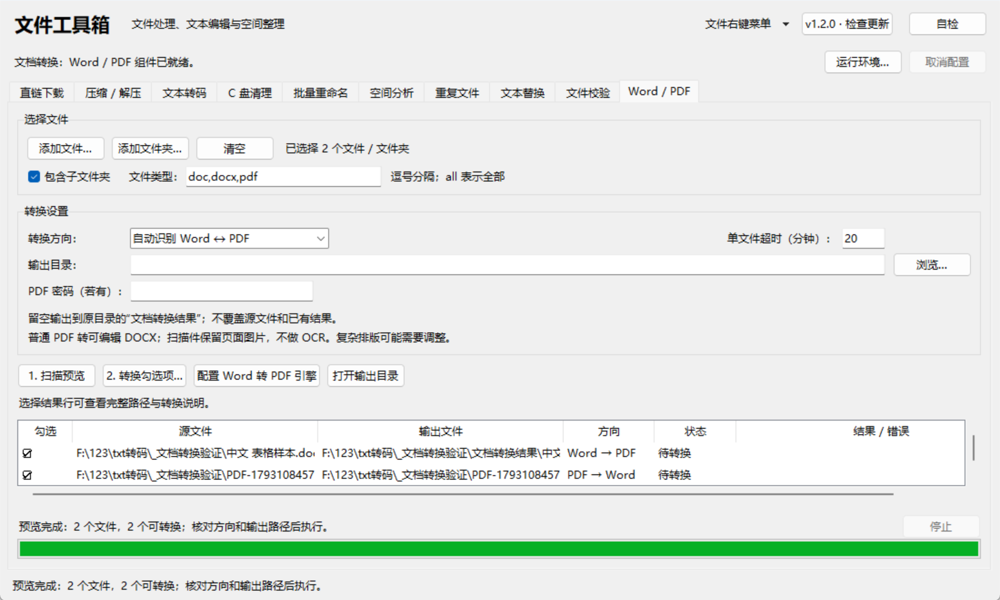
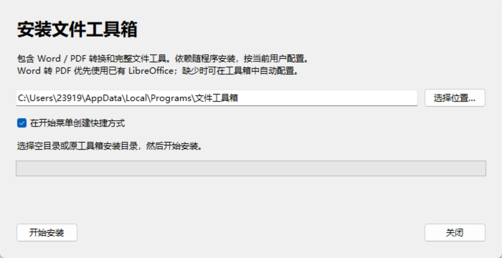

# Word 与 PDF 转换和安装包

文件工具箱 1.2.0 新增第十个“Word / PDF”页签。安装包为 64 位 Windows 构建，
按当前用户安装，不需要管理员权限；PDF 转换依赖随安装包提供，不需要安装 Python。

## 使用方法

1. 添加 `.doc`、`.docx` 或 `.pdf` 文件，也可添加文件夹；默认包含子目录。
2. 选择自动互转，或明确指定 Word 转 PDF、PDF 转 Word。
3. 设置输出目录；留空会在各源文件所在目录创建“文档转换结果”。
4. 先扫描预览，检查勾选项、转换方向和输出路径，确认后执行。

输出永不覆盖源文档或已有同名结果；多个输入会生成同名目标时先报告冲突。
扫描后源文件内容改变会阻止转换，需重新预览。转换通过独立工作进程完成，单文件默认超时 20 分钟，
可设置 0.5～120 分钟；停止或关闭会终止本次转换的进程组，不按进程名称结束用户的其它 Office 窗口。
已完成文件保留，当前未完成的结果不发布。所有转换在本机进行，不上传文档。



## 转换效果与限制

- Word 转 PDF 支持 DOC / DOCX，使用 LibreOffice。字体与原软件不同时，分页或间距可能变化。
- 普通 PDF 转 DOCX 使用 pdf2docx，尝试恢复可编辑文字、图片和表格。复杂栏位、公式、特殊字体、表单和分页可能需要手工调整。
- 没有可提取文字的扫描 / 图像 PDF 会逐页保留为 Word 页面图片，状态中明确标注没有 OCR，图片内文字不可直接编辑。
- PDF 有密码时可在页面填写；密码不正确会拒绝转换，不写入个人配置或结果报告。
- 加密 DOCX 需先解密；受保护的旧 DOC 可能无法转换。转换不保留 PDF 的数字签名、交互表单等专用功能。

已用中文、英文、网格表格、两页扫描件、加密 PDF 做真实转换和页面渲染验证。
示例验证结果可以用 `python document_selftest.py --real` 在本地重新生成；只有需要该验证时才需源码依赖。

## 文档引擎与依赖

PDF 转 Word 的安装包依赖包括 pdf2docx、PyMuPDF、python-docx、NumPy、OpenCV headless 和 fonttools。
主程序不会在 GUI 线程执行文档转换，工作进程使用内置的 Python 与上述依赖。
“自检”页会列出 pdf2docx、PyMuPDF、python-docx 和 LibreOffice 的加载 / 可用状态。

Word 转 PDF 优先复用已有 LibreOffice，也可在文档页点击“配置 Word 转 PDF 引擎”。
未检测到时，首次转换会自动下载官方 LibreOffice 26.8.1 x64 发布包（约 358 MB），
比对固定 SHA-256 后，用 Windows Installer 的只读数据库接口读取文件表和 CAB 数据，
再用系统解压工具展开到 `%LOCALAPPDATA%\文件工具箱\运行组件\LibreOffice-26.8.1\`。
不运行 MSI 的安装动作、不写系统软件目录、不更改默认 Office 关联；配置中途取消不会启用半成品。
该自动配置仅提供 Windows x64 版本；其它平台可使用预先安装的 LibreOffice。

每次 Word 转换使用独立临时用户配置，关闭宏，并与已打开的 LibreOffice 窗口分离。
下载来源为 [LibreOffice 官方发布](https://www.libreoffice.org/download/)，
命令行参数参见 [LibreOffice 官方文档](https://help.libreoffice.org/latest/en-US/text/shared/guide/start_parameters.html)。
PDF 转 DOCX 的行为参见 [pdf2docx 文档](https://pdf2docx.readthedocs.io/en/latest/)。

## 安装与卸载

运行 `dist\文件工具箱安装包.exe`，选择空目录或本安装器创建的工具箱目录后安装。
默认位置为 `%LOCALAPPDATA%\Programs\文件工具箱`，可选开始菜单快捷方式。
安装前请先关闭正在运行的工具箱。安装器逐文件校验 SHA-256，写入失败会回退已经替换的程序文件。
原目录中未列入安装清单的个人文件会保留；不会向一个已有其它文件的普通目录直接覆盖安装。



安装后可从开始菜单或安装目录启动；Windows“已安装的应用”中提供卸载入口，也可运行安装目录中的 `uninstall.ps1`。
卸载只处理本安装清单中的文件及由本次安装拥有的菜单入口，个人下载、用户目录配置和运行组件保留。
主程序不能单独移动：`文件工具箱.exe` 与相邻的 `_internal` 文件夹必须一起保留。
仓库 `dist\文件工具箱.exe` 路径仍可直接运行；分发给其它电脑推荐使用安装包。

## 开发与打包

基础工具仍可在 Python 3.9 及以上运行。此文档转换安装包使用 Python 3.14 x64 的独立构建环境，
通过固定 PyMuPDF 版本避开与转换无关的布局模型组件，依赖版本见 `requirements-documents.txt`。

```powershell
py -m venv .venv-document-build
.venv-document-build\Scripts\python.exe -m pip install -r requirements-build.txt
.venv-document-build\Scripts\python.exe build_exe.py
```

构建输出程序目录和按用户安装的安装包；`--app-only` 只生成程序目录。
安装包由现有 PyInstaller 和标准库安装器生成，不需要额外安装安装器编译软件。
`--extract-only <空目录>` 仅做安装包校验 / 解包，不写注册表或创建快捷方式，用于验证与便携部署。

源码可运行 `python document_selftest.py` 做离线保护测试，不需要文档第三方包；
`--real` 需要安装文档依赖和已有 LibreOffice，会生成忽略提交的 `_文档转换验证` 目录。

## 第三方许可

工具箱自有代码仍为 MIT。第三方组件保留各自许可：例如 PyMuPDF 使用 AGPL，pdf2docx 和 python-docx 使用各自的开源许可，
NumPy、OpenCV 和其它组件的声明见安装目录 `_internal\licenses` 及包元数据。
构建过程会附上实际构建版本的许可文件与来源链接。对应源码可从
[PyMuPDF](https://github.com/pymupdf/PyMuPDF)、[pdf2docx](https://github.com/ArtifexSoftware/pdf2docx)、
[python-docx](https://github.com/python-openxml/python-docx)、[NumPy](https://github.com/numpy/numpy) 和
[OpenCV](https://github.com/opencv/opencv) 获取；工具箱源码位于本仓库。
